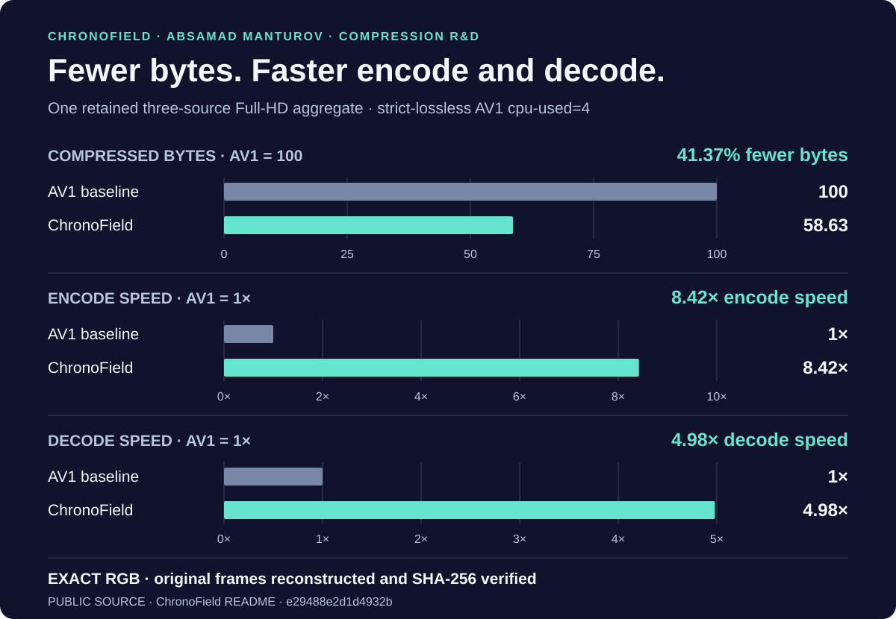
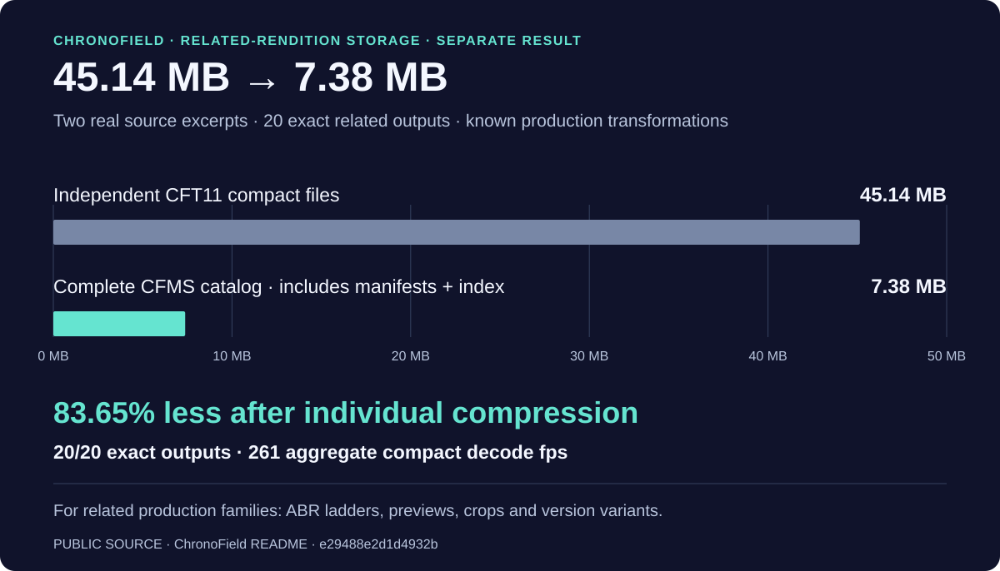

# ChronoField

**A native exact-video codec and a storage system for related production renditions.**

I am **Absamad Manturov**, founder of ChronoField. My research connects the codec and native decoder, related-rendition storage and retained size/speed comparisons. The objective is practical: keep the original RGB pixels while reducing storage and processing cost.

[Research case](https://github.com/Absamad-dew/engineering-portfolio/blob/main/research/README.md) · [Обзор на русском](https://github.com/Absamad-dew/engineering-portfolio/blob/main/research/README.ru.md) · [Investor deck](ChronoField-safe-investor-deck.pdf) · [Competitive context](COMPETITIVE_POSITION.md)

## Smaller output and faster processing at the same operating point

The retained three-source Full-HD aggregate against strict-lossless AV1 `cpu-used=4` records:

| Metric | ChronoField result |
|---|---:|
| Compressed bytes | **41.37% fewer** |
| Encode speed | **8.42× faster** |
| Decode speed | **4.98× faster** |
| Reconstruction | **Exact RGB SHA-256** |

All three real 1080p sources produced fewer bytes than both measured AV1 baselines. This joint operating point is relevant to exact-source media, archives, AI/computer-vision datasets and scientific workflows where original pixels matter.

## Storage across related renditions

Individual compression is one layer. A separate retained family-storage experiment reduced **45.14 MB of independent CFT11 compact files to a 7.38 MB complete CFMS catalog**, including manifests and index. That is an additional **83.65% reduction**, with **20/20 exact outputs** and **261 aggregate compact decode fps**.

This experiment uses two real source excerpts and 20 related outputs generated through known production transformations, such as ABR ladders, previews, crops and version variants. It is a separate population from the Full-HD comparison above. [Scope and competitive position](COMPETITIVE_POSITION.md).

## Breadth of the retained work

The machine-readable result archive contains **225 recorded CFT-versus-AV1 size comparisons: 225 wins, no ties and no losses**, across 62 result files and 33 benchmark suites.

The published system is **CFT11 0.28.0 with native decoder v8**. Its release gate passes 529 tests; the combined CFT + CFMS regression passes 598/598. The retained wire formats and artifacts remain unchanged. These are separate release/regression scopes.

Additional published operating points

| Mode / comparison | Retained result |
|---|---|
| Ultra Fast | Up to 45.63× encode speed with 37.87% fewer bytes on the compared exact Full-HD frames |
| Archive | Up to 55.25% fewer bytes than the measured AV1 lossless baseline |
| Full family catalog | 34.85× smaller than raw RGB; all 18 derived renditions add zero object payload in the tested family |

These are additional recorded operating points; their maxima are not combined into the common three-source aggregate above.

## Measurement context and next milestone

Measurements were collected on the same source frames and host: a Lenovo laptop with **AMD Ryzen 7 H 255, 8 cores / 16 threads, integrated Radeon 780M and 16 GB RAM**. Promoted outputs reconstruct the original RGB bytes exactly. The Full-HD table uses strict-lossless AV1 `cpu-used=4`; the rendition-family result has its own complete-catalog baseline.

The next milestone is **controlled independent reproduction on third-party hardware and independently selected content**, followed by server/GPU optimization and design-partner evaluations. [Detailed competitive note](COMPETITIVE_POSITION.md) · [Existing public result snapshot](https://github.com/Absamad-dew/chronofield-investor-materials/blob/e29488e2d1d4932bc94957d0d0c8ac60fff4b4e5/README.md).

## Fundraising

ChronoField is raising a **$500k-$1m pre-seed round**. The minimum round size
is **$500k**; larger scope is welcome where it supports independent blind
validation, a reproducible Linux/server and GPU build, third-party corpus
expansion, IP/FTO work and qualified design-partner evaluations.

## Materials and contact

- [Non-confidential investor deck](ChronoField-safe-investor-deck.pdf)
- [Competitive position](COMPETITIVE_POSITION.md)
- [Other engineering work](https://github.com/Absamad-dew/engineering-portfolio)
- [Independent standard-codec measurement tooling](https://github.com/Absamad-dew/compression-observatory)

**Absamad Manturov — Founder** · [Email](mailto:absamad.manturov@gmail.com) · [Telegram](https://t.me/Absamad_m)

The source code, binaries, formulas, dictionaries, bitstream grammar, research corpus, internal architecture and protected implementation mechanics remain private. All rights reserved; publication grants no license to the underlying technology or these materials.
